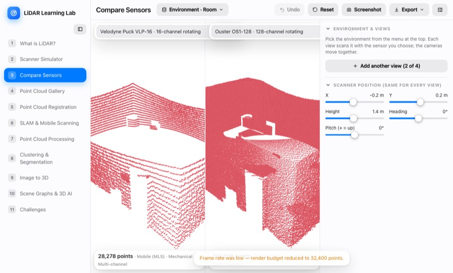
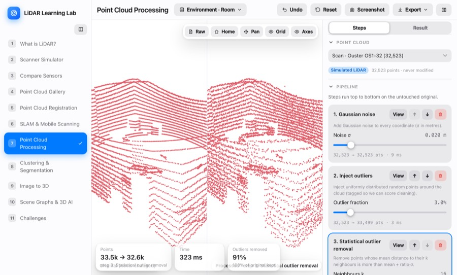
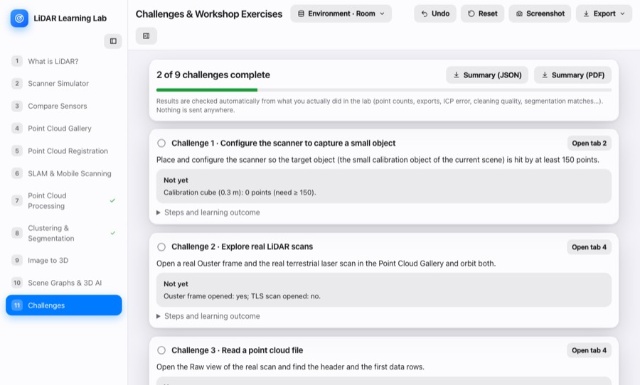

# LiDAR Learning Lab

A browser-based, hands-on lab for a 60-minute workshop on **LiDAR, point clouds, registration, SLAM, processing, segmentation, image-to-3D and scene graphs**. Virtual scanners cast real rays into 3D scenes; you can also explore real point clouds, align scans, clean and segment them. It all runs in the browser: no server, database or AI API.

**Live demo: https://maninka123.github.io/lidar-learning-lab/**

| | | |
|:-:|:-:|:-:|
|  **1 · What is LiDAR?** |  **2 · Scanner Simulator** |  **3 · Compare Sensors** |
|  **4 · Point Cloud Gallery** |  **5 · Point Cloud Registration** |  **6 · SLAM & Mobile Scanning** |
|  **7 · Point Cloud Processing** |  **8 · Clustering & Segmentation** |  **9 · Image to 3D** |
|  **10 · Scene Graphs & 3D AI** | | |

## Quick start

Needs **Node.js 20.19+ or 22+**. Keep the project on a local disk (cloud-synced folders make `node_modules` very slow).

```bash
npm install
npm run dev        # http://localhost:5173
npm run build      # type-check + production build into dist/
npm test           # unit tests (Vitest)
npm run test:e2e   # browser tests (Playwright; first run: npx playwright install chromium)
```

## Tabs

| # | Tab | What you do |
|---|-----|-------------|
| 1 | **What is LiDAR?** | A sensor, a wall and a person with no scene: time of flight, beam divergence, field of view. Click any point for its position and intensity. |
| 2 | **Scanner Simulator** | Place a scanner and set FOV, resolution, channels, range and noise; pick a scanner type with commercial presets; animated patterns for non-repetitive scanners. |
| 3 | **Compare Sensors** | Two to four sensors scan the same place side by side. |
| 4 | **Point Cloud Gallery** | Real clouds with play/pause through frames: Velodyne VLP-16, Ouster OS1-128 / OS0-128, Livox MID-360, RIEGL VZ-400 TLS. Raw file view and your own file. |
| 5 | **Point Cloud Registration** | Two clouds, no scene. Move B by hand and press Calculate, or run ICP (point-to-point / point-to-plane, match distance, trimming). 4 × 4 matrix shown on the view. |
| 6 | **SLAM & Mobile Scanning** | City district: moving scans (handheld, vehicle, UAV with adjustable height), then a SLAM run with drift and loop closure. |
| 7 | **Point Cloud Processing** | Pipeline of filters on an untouched original: crop, voxel, noise, outliers, SOR/ROR, normals. |
| 8 | **Clustering & Segmentation** | RANSAC planes, Euclidean clustering, DBSCAN, scoring against ground truth. |
| 9 | **Image to 3D** | Scene and input images, three reconstruction methods, surface meshing (voxel / smoothed), alignment with scale, error map. |
| 10 | **Scene Graphs & 3D AI** | Nodes and geometric relations, offline question answering, link to [local-llm-fit](https://maninka123.github.io/local-llm-fit/). |
| 11 | **Challenges** | Nine auto-checked exercises with a JSON / PDF summary. |

Viewport controls: left-drag rotates, right-drag or the **Pan** button moves the cloud, wheel zooms.

## What is real, what is simplified

* **Scanning is real ray casting** against boxes, cylinders and spheres, with range noise. Intensity uses a simple model, `I ≈ ρ·cosθ / (1 + (r/r₀)²)`. Sensor presets use approximate public datasheet values.
* **SLAM** is a teaching model: injected odometry error or ICP scan matching, and a loop closure that is ICP plus spreading the residual. Not a pose-graph back-end.
* **Segmentation labels** shown are simulator ground truth, not predictions of a trained model.
* **Image to 3D** is simulated (ray-cast renders, depth-error models, depth fusion). No NeRF or Gaussian-splatting output is bundled; you can upload your own result.
* **Scene-graph answers** come from an offline rule matcher, not an LLM.

## Data

| Dataset | Source | Licence |
|---|---|---|
| Scenes A–D (room, workshop, street, city) | Procedural, this repo | MIT |
| RIEGL VZ-400 tree (TLS) | [Zenodo 5076045](https://zenodo.org/records/5076045), UCL | CC BY 4.0 |
| Ouster OS1-128 / OS0-128 frames | [ouster-sdk](https://github.com/ouster-lidar/ouster-sdk) test data | BSD-3-Clause |
| Livox MID-360 frames | [Zenodo 14841855](https://zenodo.org/records/14841855), AIST | CC BY 4.0 |
| Velodyne VLP-16 frames | [Keio-CSG/lidar-spoofing-artifacts](https://github.com/Keio-CSG/lidar-spoofing-artifacts) | no licence stated, credit Keio-CSG |
| Your files | PLY, PCD (incl. compressed), LAS 1.0–1.4 | yours |

Units are metres, Z-up. LAZ is not decoded in the browser (`pdal translate in.laz out.las`).

## Code layout

```
src/core  src/scenes  src/sensor  src/processing  src/segmentation  src/registration
src/recon  src/graph  src/io  src/engine (Web Workers)  src/exercises  src/state  src/ui  src/tabs
tests/ (Vitest)   e2e/ (Playwright)   docs/screens/ (README images)
```

Stack: React, TypeScript, Vite, Three.js + React Three Fiber, Zustand, Tailwind CSS. A push to `main` deploys to GitHub Pages through `.github/workflows/pages.yml` (Settings → Pages → Source: GitHub Actions).

## Related

[Rotating Target Calibration Studio](https://github.com/maninka123/rotating-target-calibration-studio) (scan architectures) · [Model Fit Explorer](https://github.com/maninka123/local-llm-fit) (which local LLM can you run) · Licence: MIT, see [LICENSE](LICENSE).
