<p align="center"></p>

**Welcome, and thanks for stopping by.** 👋

A small, friendly place to *play* with LiDAR. No scanner, licence or install: open the page and start. Fire laser beams into a room, line two scans up, turn a classroom into a floor plan, spot what changed. Everything is a simulation you can poke, break and fix, with plain-English notes beside every control.

**Start here: https://maninka123.github.io/lidar-learning-lab/**

| | | |
|:-:|:-:|:-:|
| 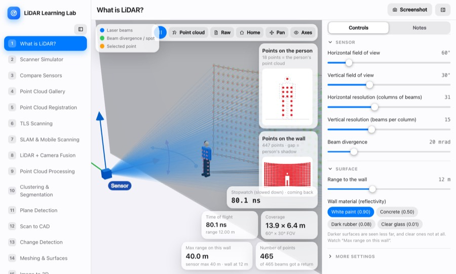 **What is LiDAR?** | 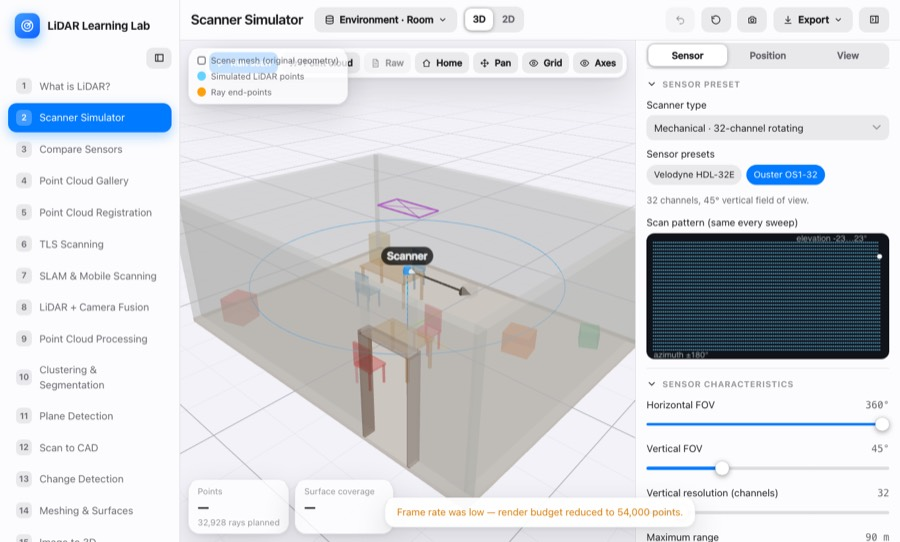 **Scanner Simulator** | 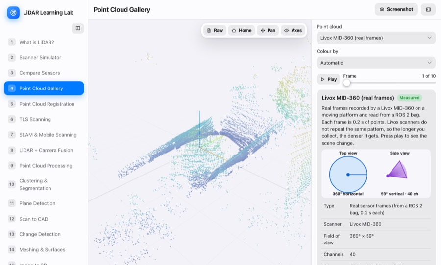 **Real point clouds** |
| 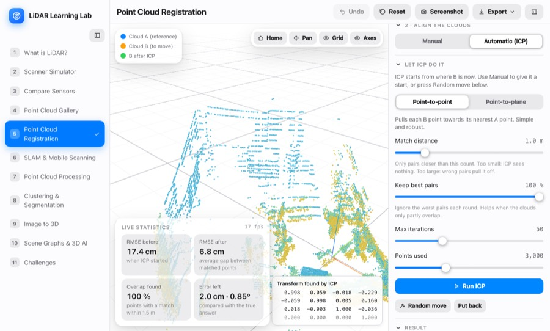 **Registration** | 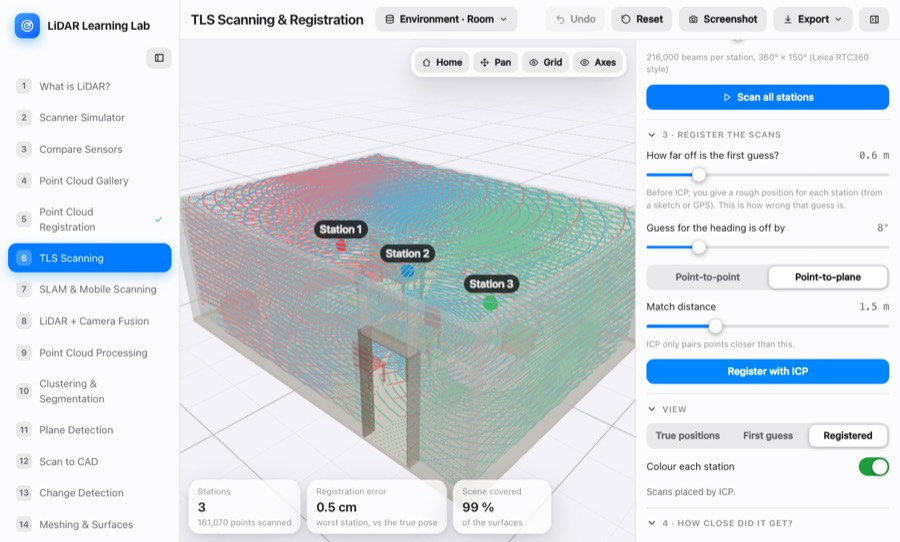 **TLS stations** | 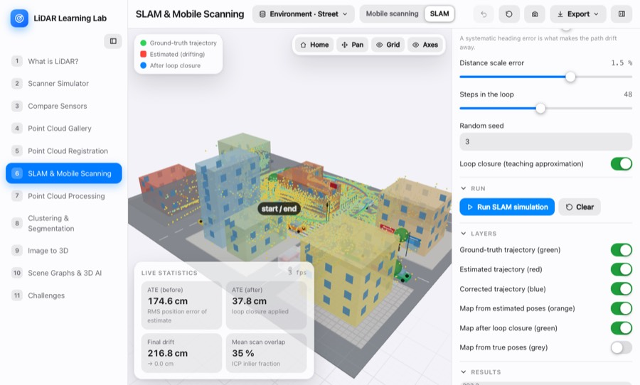 **SLAM** |
| 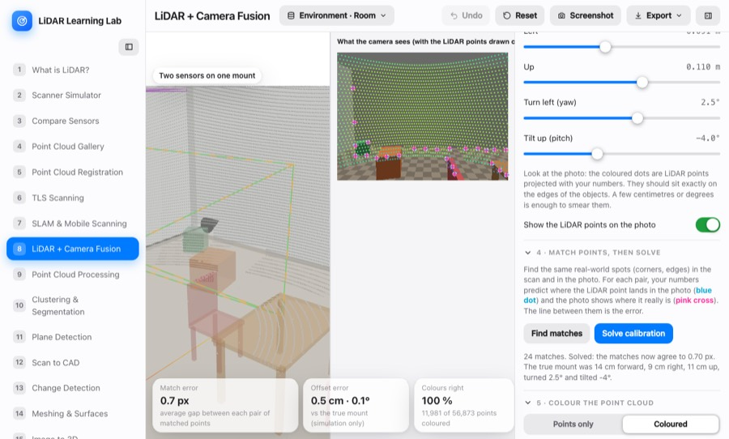 **LiDAR + camera** | 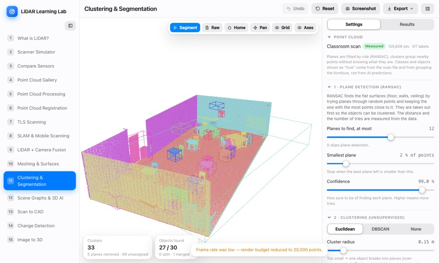 **Segmentation** | 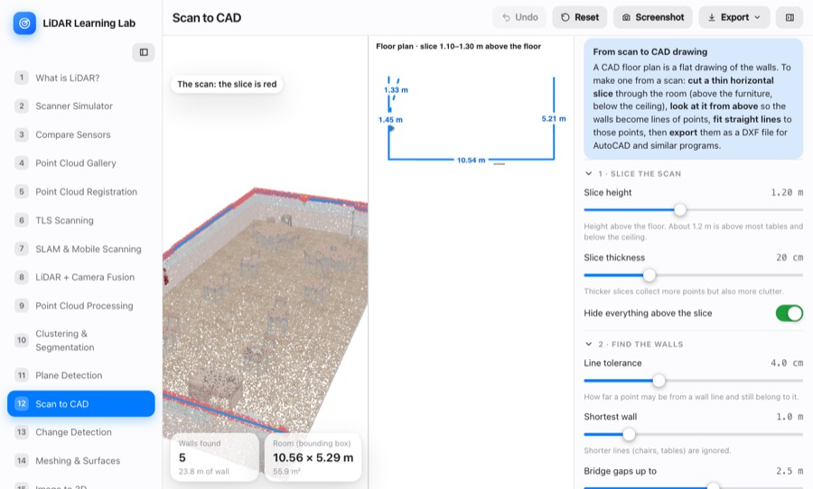 **Scan to CAD** |
| 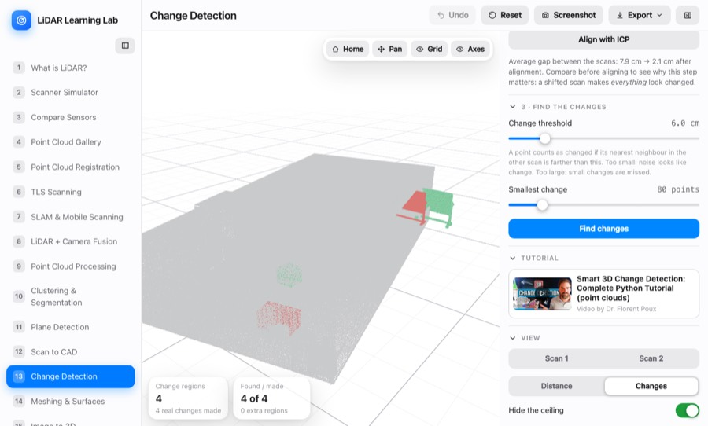 **Change detection** | 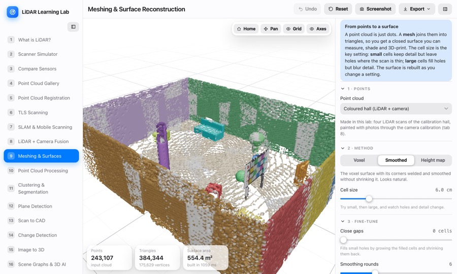 **Meshing** | 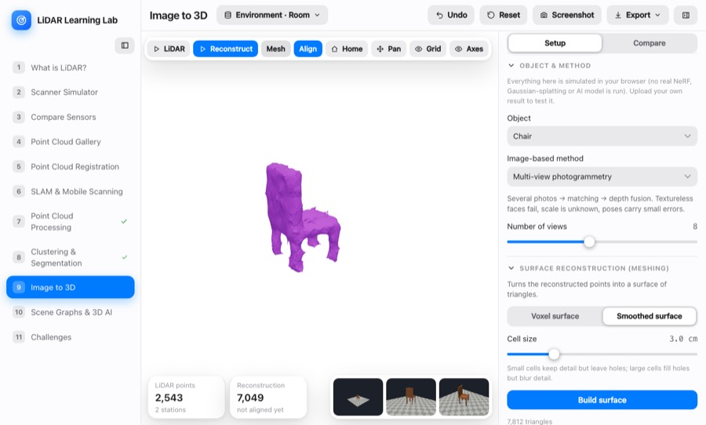 **Image to 3D** |

## A good way to use it

Go through the tabs in order, one idea at a time, about five minutes each. Each tab starts with a short "what is this?" box and its controls are in the order you need them (1 → 2 → 3). Or jump straight to what you are curious about.

## Tabs

| # | Tab | What you do |
|---|-----|-------------|
| 1 | **What is LiDAR?** | A sensor, a wall and a person: time of flight, beam spread, field of view. Click any point for its position and intensity. |
| 2 | **Scanner Simulator** | Place a scanner and set FOV, resolution, channels, range and noise, or pick a real preset (Velodyne, Ouster, Hesai, Livox…). |
| 3 | **Compare Sensors** | Two to four sensors scan the same place side by side. |
| 4 | **Point Cloud Gallery** | Real clouds you can play through frame by frame (VLP-16, Ouster, MID-360, RIEGL TLS). Raw file view; open your own file. |
| 5 | **Occlusion & Sensor Placement** | Why a laser cannot see everything. Place up to four scanners, see what each one covers, compare two placements, and take three challenges (Room, Workshop, Street). Coverage is visible surface area, not point counts. |
| 6 | **Point Cloud Processing** | A pipeline of filters on an untouched original: crop, voxel, noise, outliers, normals. |
| 7 | **Point Cloud Registration** | Align two clouds by hand or with ICP (point-to-point or point-to-plane), with the 4×4 matrix on screen. A guided "How ICP works" lesson replays a real run, including how it fails. |
| 8 | **Change Detection** | Five visits to the same classroom; a distance heatmap shows what changed between any two. |
| 9 | **TLS Scanning** | Place tripod stations, scan, and register the scans into one cloud. The true positions are known, so you see how close you got. |
| 10 | **SLAM & Mobile Scanning** | Handheld, vehicle or UAV scanning in a city with a choice of three LiDARs (VLP-16, Hokuyo, Mid-360). Pick a ready-made route or draw one, set the speed, and see drift and loop closure. Includes a guided "How SLAM works" lesson. |
| 11 | **LiDAR + Camera Fusion** | Move a camera into place with sliders, watch the cloud pick up colour, check the errors, save the calibration, then map a whole walk in colour. |
| 12 | **Meshing & Surfaces** | Turn coloured clouds (a hall, a classroom, a tree) into surfaces: voxel, smooth, height map, fill gaps, simplify. Export OBJ. |
| 13 | **Unsupervised Learning** (clustering & segmentation) | RANSAC plane detection (floor, walls, ceiling), then Euclidean clustering or DBSCAN, scored against the classroom furniture. |
| 14 | **Supervised Learning** (train your own model) | Drag blocks to build a small neural network and train it on 10 labelled images and 10 labelled point clouds, side by side. Choose classification, detection or segmentation; three held-back examples show whether it really learned. |
| 15 | **Scene Graphs & 3D AI** | Objects and relations, offline question answering, link to local-llm-fit. |
| 16 | **Moving Scene & Temporal Graph** | A vehicle scans a street every 0.8 s. Each frame is segmented, objects are tracked between frames, and events (approaching, crossing, passing) become a temporal scene graph a language model can answer questions from. |
| | **Applications (optional)** | |
| 17 | **Scan to CAD** | Slice a classroom, find wall lines, square the corners, export a DXF floor plan. |
| 18 | **Image to 3D** | Choose a scene, try three reconstruction methods, then mesh, align with scale and view the error map. |
| 19 | **Industrial Digital Twin Challenge** | Seven unlocking missions: design, register, clean, detect, add cameras, check changes and safety, then commission the system on unseen scenarios. Graded on real results; scores can go to the instructor. See docs/DIGITAL_TWIN_CHALLENGE.md. |
| 20 | **Thank You** | A calm closing page with an optional, anonymous feedback form. The admin page has a Feedback & Insights tab. See docs/FEEDBACK.md. |

Viewport: left-drag rotates, right-drag or the **Pan** button moves the cloud, wheel zooms.

## AI in the scene graph tab (optional)

Tab 15 can hand a thinned-out point cloud straight to a language model (DeepSeek V4 Flash) to show why that does not work well. It needs a key: copy `.env.example` to `.env.local` and put your DeepSeek key in it. `.env.local` is ignored by git, and the key is added by the dev / preview server, so it is never in the page or the built site. The live GitHub Pages site has no server, so there you paste your own key into the page (kept only in your browser) or skip this section: everything else works without it.

## Run it yourself

Needs **Node.js 20.19+ or 22+**. Keep the folder on a local disk (cloud-synced folders make `node_modules` very slow).

```bash
npm install
npm run dev        # http://localhost:5173
npm run build      # type-check + production build into dist/
npm test           # unit tests (Vitest)
npm run test:e2e   # browser tests (Playwright; first run: npx playwright install chromium)
```

## What is real, what is simplified

* **Scanning is real ray casting** against boxes, cylinders and spheres, with range noise. Intensity uses a simple model, `I ≈ ρ·cosθ / (1 + (r/r₀)²)`. Sensor presets use approximate public datasheet values.
* **SLAM** is a teaching model: injected odometry error or ICP scan matching, and a loop closure that is ICP plus spreading the residual. It is not a pose-graph back-end.
* **LiDAR + camera fusion** uses a simple pinhole camera and a rendered photo. The calibration solver is a standard reprojection-error fit (PnP, Levenberg–Marquardt).
* **Segmentation labels** shown are simulator ground truth, not predictions of a trained model.
* **Image to 3D** is simulated (ray-cast renders, depth-error models, depth fusion). No NeRF or Gaussian-splatting output is bundled; upload your own to compare.
* **Scene-graph answers** come from an offline rule matcher, not an LLM.

## Data and credits

The built-in scenes are procedural (MIT). The real scans come from public datasets and keep their own licences; every source is credited.

<details>
<summary><b>Datasets and licences</b> (6)</summary>

| Dataset | Source | Licence |
|---|---|---|
| Scenes A–D (room, workshop, street, city) | Procedural, this repo | MIT |
| `classroom_scene.ply` (1.4 M points, colour + labels, thinned to 1.5 cm) | Provided by the project author | see file |
| RIEGL VZ-400 tree (TLS) | [Zenodo 5076045](https://zenodo.org/records/5076045), UCL | CC BY 4.0 |
| Ouster OS1-128 / OS0-128 frames | [ouster-sdk](https://github.com/ouster-lidar/ouster-sdk) test data | BSD-3-Clause |
| Livox MID-360 frames | [Zenodo 14841855](https://zenodo.org/records/14841855), AIST | CC BY 4.0 |
| Velodyne VLP-16 frames | [Keio-CSG/lidar-spoofing-artifacts](https://github.com/Keio-CSG/lidar-spoofing-artifacts) | no licence stated, credit Keio-CSG |

</details>

<details>
<summary><b>Video credits</b>: Dr. Florent Poux</summary>

**Videos linked in the app** are by **[Dr. Florent Poux](https://www.youtube.com/@FlorentPoux)**, whose point-cloud tutorials inspired the classroom tabs. Thank you for sharing them: [Scan to CAD](https://www.youtube.com/watch?v=Z8uAzTqdSts) · [Adaptive RANSAC plane detection](https://www.youtube.com/watch?v=MJJNIvvAQzc) · [Smart 3D change detection](https://www.youtube.com/watch?v=38Fu-pDwUoA) · [The library point cloud](https://www.youtube.com/watch?v=X57nSQZePyE) · [University](https://www.youtube.com/watch?v=8nzo4YobRyc) · [Old wool factory](https://www.youtube.com/watch?v=Kq8FKKODkog) · [Implantation point cloud](https://www.youtube.com/watch?v=Hy4hnWMw5ms). The videos play from YouTube; nothing is downloaded or copied.

</details>

**AI steps (Scene Graphs, Moving Scene)** need a DeepSeek key. There are three ways to get one:

- **In a workshop:** nothing to do. Your lecturer or instructor will provide AI access for everyone during the session (you can add your name if you like).
- **On the website:** paste your own key into the box that appears. It stays in your browser.
- **On your own computer:** copy `.env.example` to `.env.local`, put `DEEPSEEK_API_KEY=your-key` in it and run `npm run dev`. The key stays on your machine and nothing needs pasting.

> **Why DeepSeek?** It offers a strong balance of reasoning capabilities, API accessibility, and cost efficiency, making it suitable for interactive classroom-scale workshops.

Everything else works without any key.

<p align="center"></p>

<p align="center">
<b>Made with care for anyone learning how machines see in 3D.</b><br>
If it helped you, a star means a lot: <a href="https://github.com/maninka123/lidar-learning-lab">⭐ Star on GitHub</a> · <a href="https://github.com/maninka123/lidar-learning-lab/issues">ideas &amp; fixes welcome</a> · <a href="https://maninka123.github.io/lidar-learning-lab/">try the lab</a>
</p>

<p align="center"><sub>MIT licence · React, TypeScript, Vite, Three.js · also <a href="https://github.com/maninka123/rotating-target-calibration-studio">Rotating Target Calibration Studio</a> and <a href="https://github.com/maninka123/local-llm-fit">Model Fit Explorer</a></sub></p>
