# LiDAR Learning Lab

**Welcome, and thanks for stopping by.** 👋

This is a small, friendly place to *play* with LiDAR. You don't need a scanner, a licence or any installed software: open the page and start. Fire laser beams into a room and watch the dots appear. Look at real scans from real sensors. Line two scans up, follow a robot as it drifts and corrects itself, turn a classroom scan into a CAD floor plan, spot what changed between two visits, give a point cloud its colours from a camera.

Everything is a simulation you can poke, break and fix, with plain-English explanations next to every control. If something is confusing, that is a bug in the lab, not in you.

**Start here: https://maninka123.github.io/lidar-learning-lab/**

| | | |
|:-:|:-:|:-:|
| 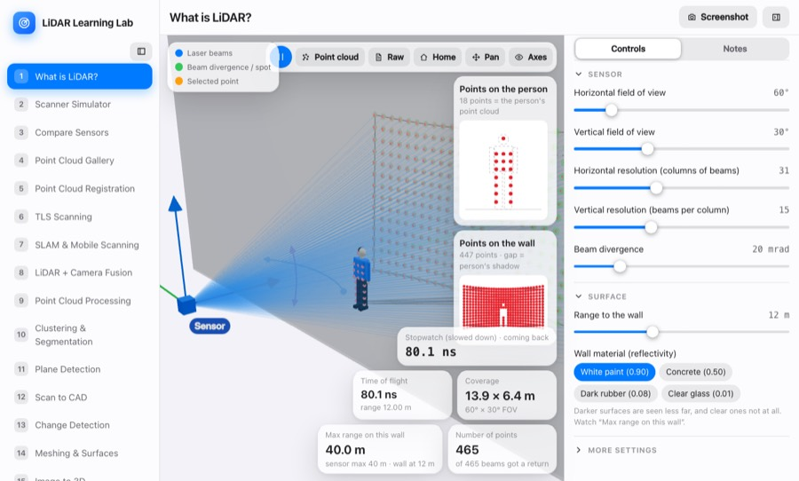 **What is LiDAR?** | 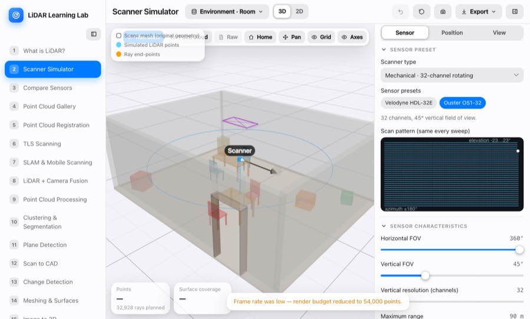 **Scanner Simulator** | 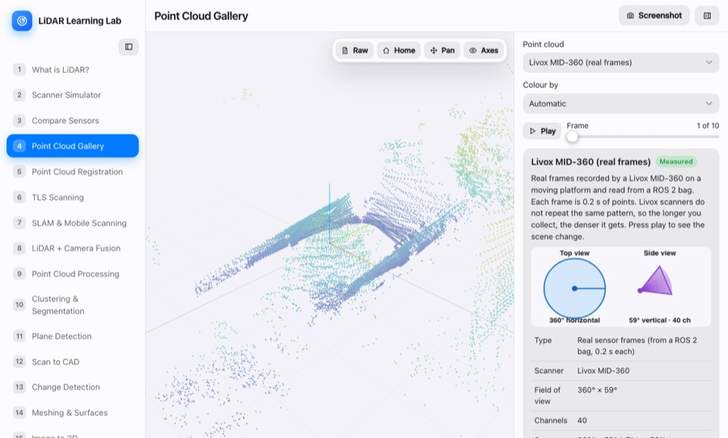 **Real point clouds** |
| 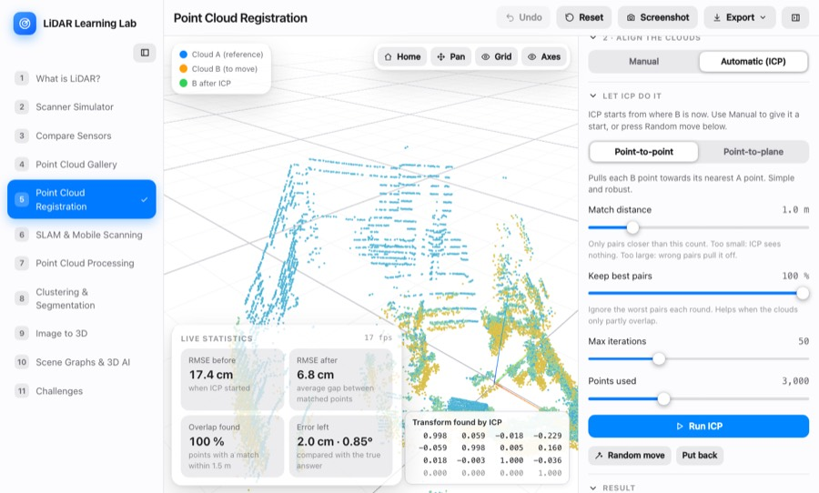 **Registration** | 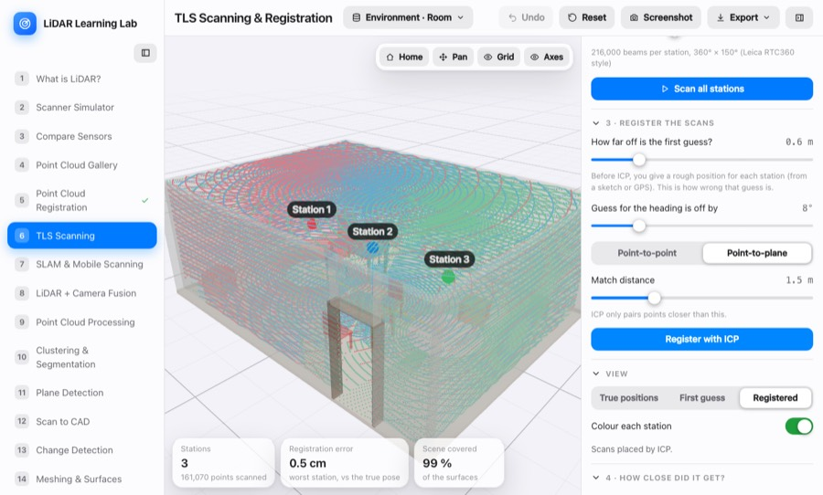 **TLS stations** | 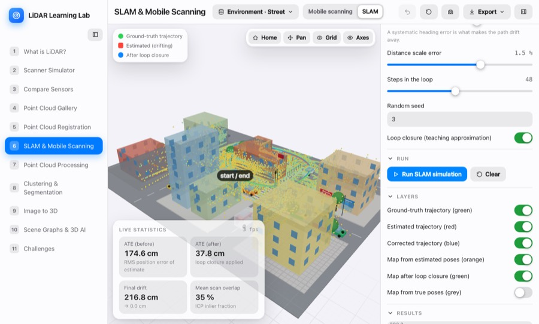 **SLAM** |
| 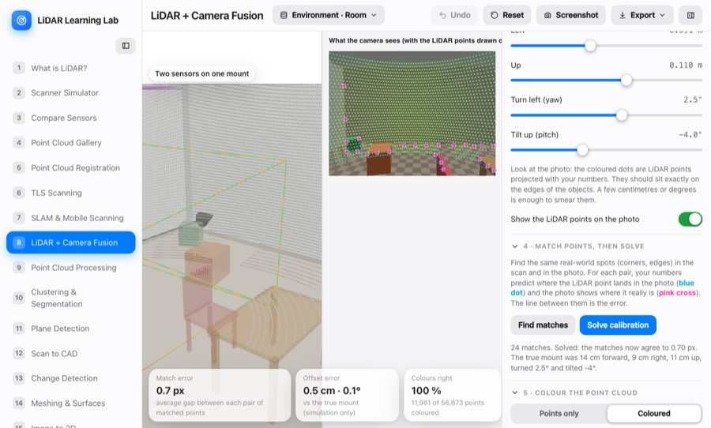 **LiDAR + camera** | 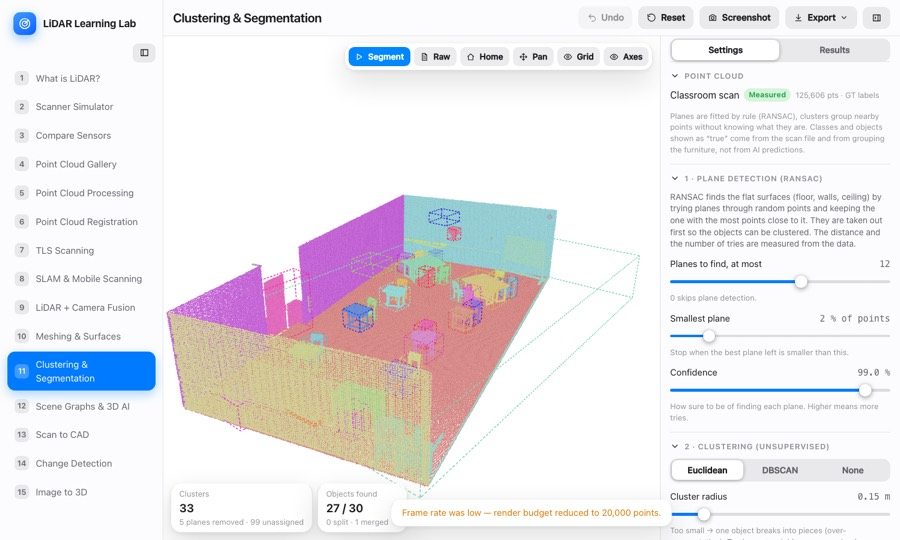 **Segmentation** | 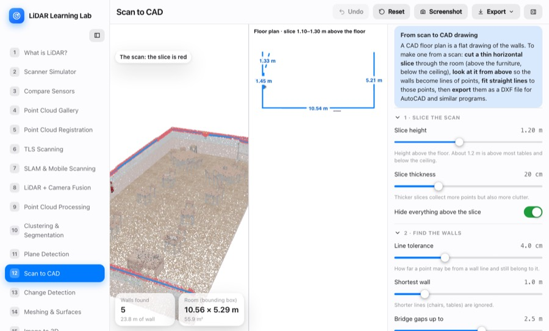 **Scan to CAD** |
| 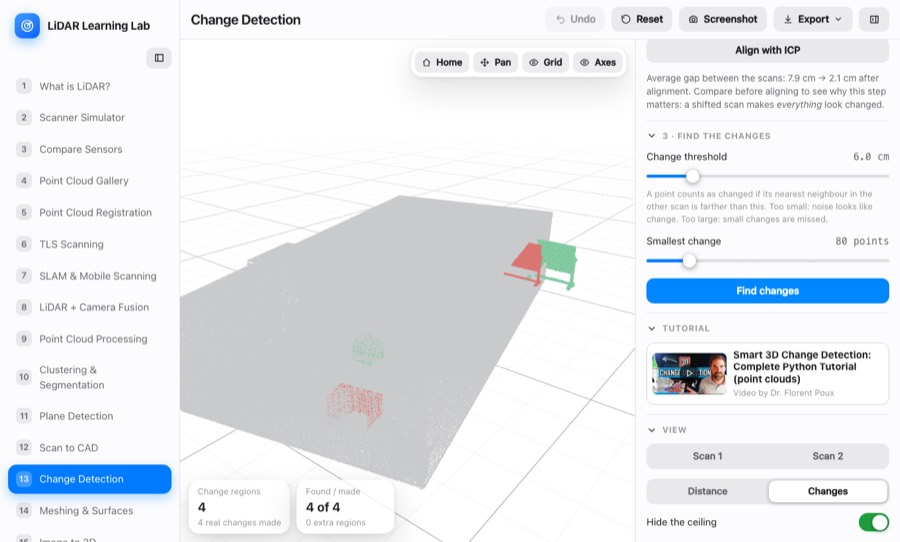 **Change detection** | 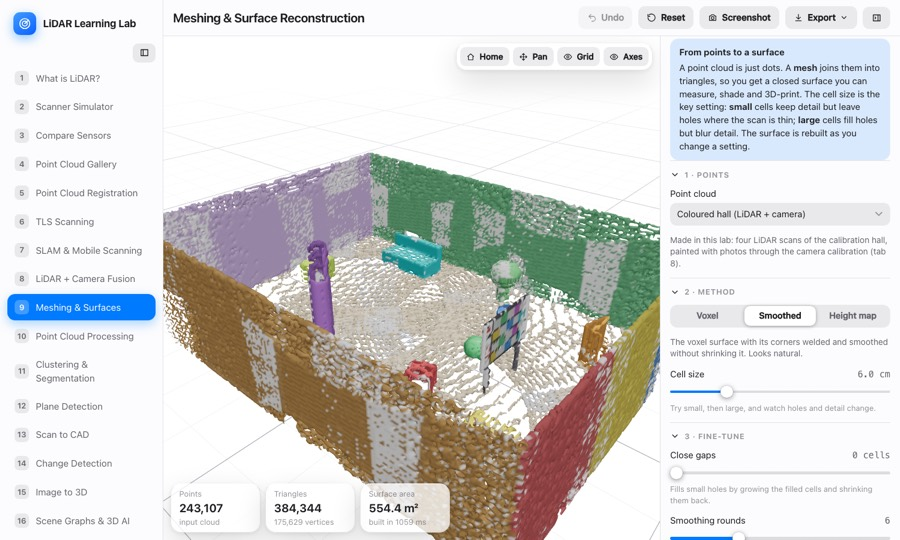 **Meshing** | 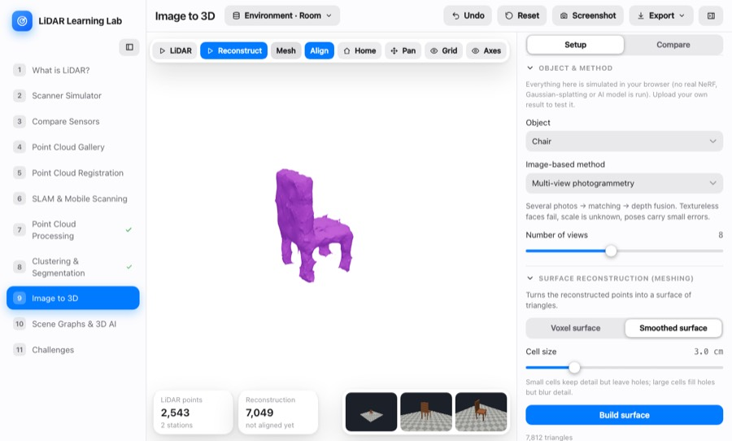 **Image to 3D** |

## A good way to use it

Go through the tabs in order, one idea at a time, about five minutes each. Each tab starts with a short "what is this?" box and its controls are in the order you need them (1 → 2 → 3). Or jump straight to what you are curious about.

## Tabs

| # | Tab | What you do |
|---|-----|-------------|
| 1 | **What is LiDAR?** | A sensor, a wall and a person: time of flight, beam divergence, field of view. Click any point for its position and intensity. |
| 2 | **Scanner Simulator** | Place a scanner, set FOV, resolution, channels, range and noise, pick commercial presets (Velodyne, Ouster, Hesai, Livox…). |
| 3 | **Compare Sensors** | Two to four sensors scan the same place side by side. |
| 4 | **Point Cloud Gallery** | Real clouds with play/pause through frames: Velodyne VLP-16, Ouster OS1/OS0, Livox MID-360, RIEGL TLS. Raw file view; open your own file. |
| 5 | **Point Cloud Processing** | A pipeline of filters on an untouched original: crop, voxel, noise, outliers, normals. |
| 6 | **Point Cloud Registration** | Two clouds, no scene. Move one by hand or run ICP (point-to-point / point-to-plane); the 4×4 matrix is drawn on the view. |
| 7 | **TLS Scanning** | Place tripod stations, scan, then register the scans into one cloud. You know the true positions, so you see how close registration gets. |
| 8 | **SLAM & Mobile Scanning** | Moving scans in a city (handheld, vehicle, UAV) and a SLAM run with drift and loop closure. |
| 9 | **LiDAR + Camera Fusion** | A colourful hall, a LiDAR and a camera. Move the camera into place with translation and rotation sliders, watch the point cloud colour change, press Calculate to see the errors zoomed in, save the calibration, then map a whole walk in colour in a pop-up. |
| 10 | **Meshing & Surfaces** | Coloured point clouds (the hall from tab 8, a classroom, a tree) into surfaces: voxel, smoothed, height map, close gaps, simplify, colour from the points, export OBJ. |
| 11 | **Clustering & Segmentation** | RANSAC plane detection (floor, walls, ceiling taken out with a few settings), then Euclidean clustering or DBSCAN on the same classroom scan, scored against its furniture. |
| 12 | **Scene Graphs & 3D AI** | Objects and relations, offline question answering, link to [local-llm-fit](https://maninka123.github.io/local-llm-fit/). |
| 13 | **Scan to CAD** | Slice a classroom, find wall lines, square the corners, export a **DXF** floor plan. |
| 14 | **Change Detection** | Two scans of a room, align, measure distances, threshold, group: what was removed, moved or added? |
| 15 | **Image to 3D** | Scene and input images, three reconstruction methods, meshing, alignment with scale, error map. |

Viewport: left-drag rotates, right-drag or the **Pan** button moves the cloud, wheel zooms.

## AI in the scene graph tab (optional)

Tab 12 can hand a thinned-out point cloud straight to a language model (DeepSeek V4 Flash) to show why that does not work well. It needs a key: copy `.env.example` to `.env.local` and put your DeepSeek key in it. `.env.local` is ignored by git, and the key is added by the dev / preview server, so it is never in the page or the built site. The live GitHub Pages site has no server, so there you paste your own key into the page (kept only in your browser) or skip this section: everything else works without it.

## Run it yourself

Needs **Node.js 20.19+ or 22+**. Keep the folder on a local disk (cloud-synced folders make `node_modules` very slow).

```bash
npm install
npm run dev        # http://localhost:5173
npm run build      # type-check + production build into dist/
npm test           # unit tests (Vitest)
npm run test:e2e   # browser tests (Playwright; first run: npx playwright install chromium)
```

## What is real, what is simplified

* **Scanning is real ray casting** against boxes, cylinders and spheres, with range noise. Intensity uses a simple model, `I ≈ ρ·cosθ / (1 + (r/r₀)²)`. Sensor presets use approximate public datasheet values.
* **SLAM** is a teaching model: injected odometry error or ICP scan matching, and a loop closure that is ICP plus spreading the residual. It is not a pose-graph back-end.
* **LiDAR + camera fusion** uses a simple pinhole camera and a rendered photo. The calibration solver is a standard reprojection-error fit (PnP, Levenberg–Marquardt).
* **Segmentation labels** shown are simulator ground truth, not predictions of a trained model.
* **Image to 3D** is simulated (ray-cast renders, depth-error models, depth fusion). No NeRF or Gaussian-splatting output is bundled; upload your own to compare.
* **Scene-graph answers** come from an offline rule matcher, not an LLM.

## Data and credits

| Dataset | Source | Licence |
|---|---|---|
| Scenes A–D (room, workshop, street, city) | Procedural, this repo | MIT |
| `classroom_scene.ply` (1.4 M points, colour + labels, thinned to 1.5 cm) | Provided by the project author | see file |
| RIEGL VZ-400 tree (TLS) | [Zenodo 5076045](https://zenodo.org/records/5076045), UCL | CC BY 4.0 |
| Ouster OS1-128 / OS0-128 frames | [ouster-sdk](https://github.com/ouster-lidar/ouster-sdk) test data | BSD-3-Clause |
| Livox MID-360 frames | [Zenodo 14841855](https://zenodo.org/records/14841855), AIST | CC BY 4.0 |
| Velodyne VLP-16 frames | [Keio-CSG/lidar-spoofing-artifacts](https://github.com/Keio-CSG/lidar-spoofing-artifacts) | no licence stated, credit Keio-CSG |

**Videos linked in the app** are by **[Dr. Florent Poux](https://www.youtube.com/@FlorentPoux)**, whose point-cloud tutorials inspired the classroom tabs. Thank you for sharing them: [Scan to CAD](https://www.youtube.com/watch?v=Z8uAzTqdSts) · [Adaptive RANSAC plane detection](https://www.youtube.com/watch?v=MJJNIvvAQzc) · [Smart 3D change detection](https://www.youtube.com/watch?v=38Fu-pDwUoA) · [The library point cloud](https://www.youtube.com/watch?v=X57nSQZePyE) · [University](https://www.youtube.com/watch?v=8nzo4YobRyc) · [Old wool factory](https://www.youtube.com/watch?v=Kq8FKKODkog) · [Implantation point cloud](https://www.youtube.com/watch?v=Hy4hnWMw5ms). The videos play from YouTube; nothing is downloaded or copied.

Units are metres, Z-up. LAZ is not decoded in the browser (`pdal translate in.laz out.las`).

## Code layout

```
src/core  scenes  sensor  processing  segmentation  registration  recon  graph  io  engine (Web Workers)
src/apps  (classroom: planes, CAD, change detection, meshing, fusion maths)
state  ui  tabs      tests/ (Vitest)      e2e/ (Playwright)      docs/screens/
```

Stack: React, TypeScript, Vite, Three.js + React Three Fiber, Zustand, Tailwind CSS. A push to `main` deploys to GitHub Pages (`.github/workflows/pages.yml`; Settings → Pages → Source: GitHub Actions).

Related: [Rotating Target Calibration Studio](https://github.com/maninka123/rotating-target-calibration-studio) · [Model Fit Explorer](https://github.com/maninka123/local-llm-fit) · Licence: MIT, see [LICENSE](LICENSE).

Made with care for anyone learning how machines see in 3D. Questions, ideas and fixes are very welcome.
